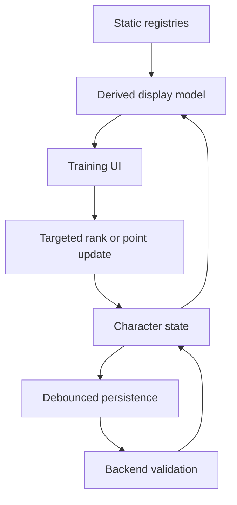

> Historical design material: Core Checks and ranked Specialties are retired. See [current Training rules](../training.md) for implemented behavior. Path progression proposals here are not implemented.

# Data Flow

This document defines the intended lifecycle for progression data from registries through UI rendering, editing, validation, and persistence.

## Source Data

Static rule definitions live in registries:

- Core Check definitions describe rollable stats, linked Attributes, categories, and presentation metadata.
- Specialty definitions describe ranked techniques, related Core Checks, effects, prerequisites, tags, and context.
- Faction and archetype definitions describe starting affinities, rewards, and thematic constraints.

Registries should be treated as immutable during a running character builder session.

## Character State

Character state stores player-specific choices:

- Attribute allocations
- Core Check investments
- Specialty ranks
- faction, archetype, heritage, and background choices
- progression currencies spent and remaining

Character state should reference registry ids rather than copying full registry objects. This keeps saves smaller and prevents stale embedded rule text from surviving registry updates.

## Training Page Flow

The Training page should derive display rows from two inputs:

1. immutable registry definitions
2. mutable character progression state

Core Training rows combine Core Check definitions with current numeric values. Specialty Training rows combine Specialty definitions with current rank and next-rank eligibility.

Expensive derived display data should be memoized by item id and rank where possible.

## Persistence Flow

Autosave should receive normalized character state, not fully expanded display rows.

Recommended flow:

```text
User clicks rank control
-> targeted reducer updates one Specialty rank
-> affected row derives current/next display state
-> debounced persistence writes normalized character state
-> backend validates against registries on save or submission
```

Autosave should not run heavy global prerequisite checks on every click unless the action changes a dependency that can invalidate many other choices.

## Backend Boundary

The backend should validate progression against the canonical registry model. It should reject impossible states but avoid encoding UI-only display assumptions.

Backend responses may include normalized summaries for convenience, but the frontend should still be able to render from registry definitions plus character state.

## Diagram


