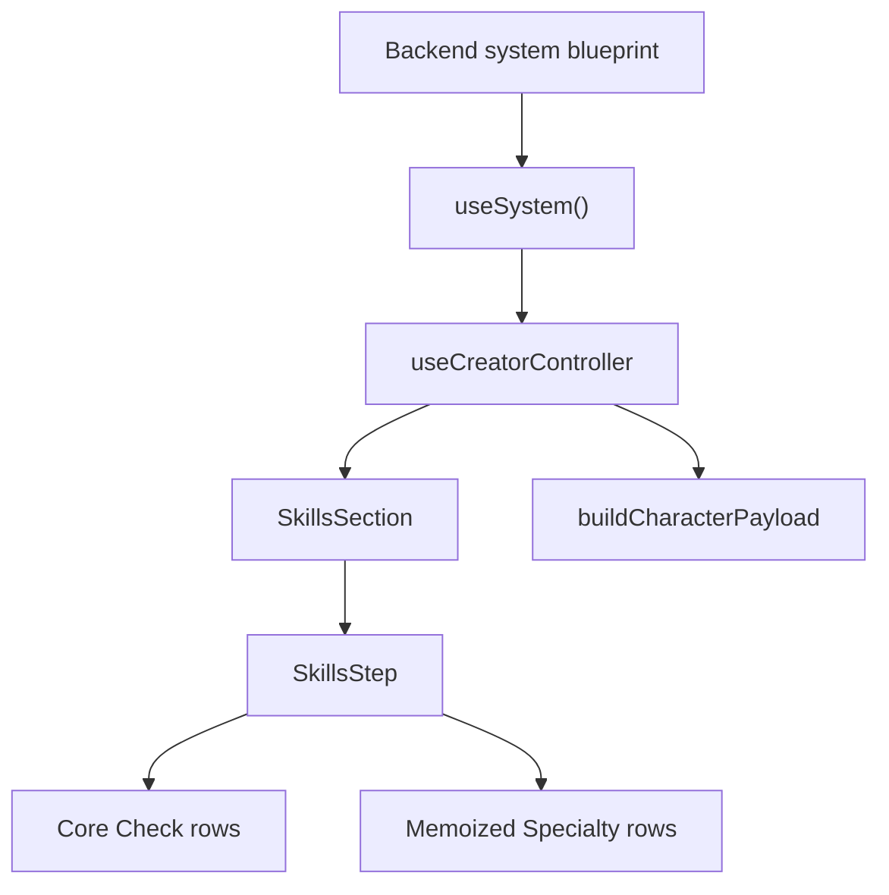

# Training Page Flow

The Training page connects Core Point investment and Specialty rank selection.

## Data Flow



## Core Training Flow

1. The blueprint provides Core Check definitions.
2. Attribute values plus `progression.coreCheckInvestments` produce final Core Check values.
3. Core Check rows display formulas, linked Attributes, values, and investment controls.
4. Saving writes derived `checks` and progression investments.

## Specialty Training Flow

1. The blueprint provides the Specialty registry.
2. Character state stores only selected Specialty ids and ranks.
3. The UI derives a rank map once per `skills` change.
4. Each Specialty row receives its own rank as a primitive prop.
5. Tooltip detail is lazy-rendered on hover/focus.

## Performance Contract

Specialty rank clicks should not rebuild heavy UI for every row.

Required patterns:

- pass row-level props instead of whole state objects
- memoize row components
- avoid inline full rank trees
- lazy-render tooltip detail
- use stable callbacks for rank updates

## Update Handler

The rank update handler should:

- clamp by `specialty.maxRank`
- update only the relevant category array
- reject changes that exceed available Specialty picks
- avoid backend persistence until the user explicitly saves

Temporary profiling can be enabled in the console:

```js
globalThis.__ARCHIPELAGO_PROFILE_SPECIALTIES__ = true
```

This logs Specialty row renders and rank update timing.
