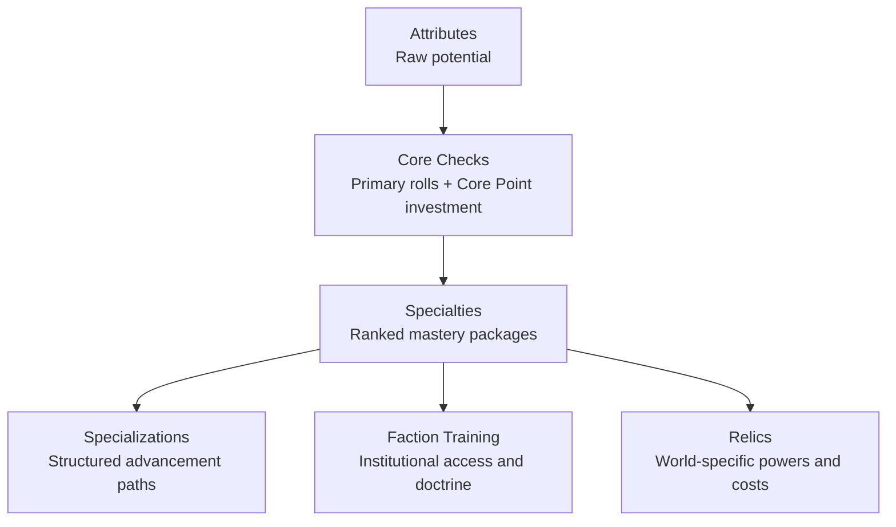

> Historical design material: Core Checks and ranked Specialties are retired. See [current Training rules](../training.md) for implemented behavior. Path progression proposals here are not implemented.

# Progression Layers Diagram

Use this diagram when explaining why Core Checks and Specialties must remain separate.
