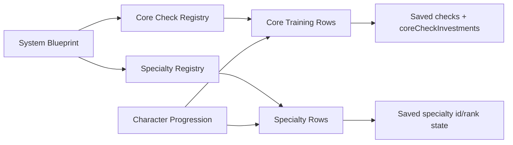

> Historical design material: Core Checks and ranked Specialties are retired. See [current Training rules](../training.md) for implemented behavior. Path progression proposals here are not implemented.

# Training Page Flow Diagram

Core Training shows formulas and values. Specialty Training shows mastery state and lazy detail.
