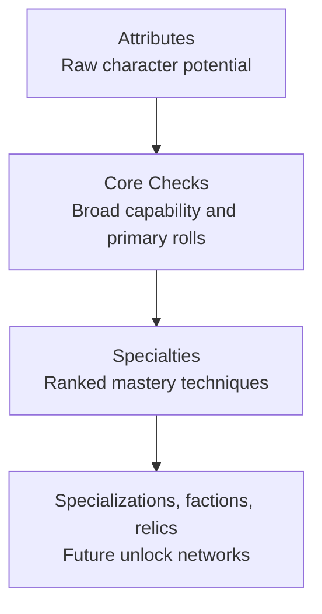

> Historical design material: Core Checks and ranked Specialties are retired. See [current Training rules](../training.md) for implemented behavior. Path progression proposals here are not implemented.

# Progression Philosophy

Sanguine Archipelago uses layered progression. Each layer answers a different player-facing question and must remain mechanically distinct.

## Three Layers

## Attributes

Attributes describe raw human, spiritual, and instinctive potential:

- `Might`
- `Agility`
- `Wit`
- `Spirit`
- `Resolve`
- `Instinct`

Attributes are foundational. They feed Core Check math and resource ceilings, but they are not the main long-term training interface.

## Core Checks

Core Checks are the vertical progression layer.

They answer:

> What is this character broadly capable of?

Core Checks are:

- primary rolls
- direct numerical investments
- derived from Attributes plus Core Point investment
- the broad competency layer every Specialty depends on

Examples:

- `Guard`: defending against direct danger, forced movement, and immediate harm.
- `Precision`: exact action under pressure, including aim and controlled strikes.
- `Presence`: commanding attention and authority before others agree to listen.
- `Patch`: restoration, repair, stabilization, and emergency intervention.

## Specialties

Specialties are the horizontal progression layer.

They answer:

> How does this character uniquely express mastery?

Specialties are:

- ranked techniques
- tactical permissions
- situational dominance packages
- identity signals
- future hooks for factions, relics, callings, and specialization trees

Specialties do not replace Core Checks. They sit on top of them.

## Example Progression

A character with `Guard 16` is broadly good at defense. A character with `Brace III` expresses that defense differently:

- Rank I: may use Guard instead of Reflex against forced movement.
- Rank II: reduces collision damage after a successful Guard response.
- Rank III: can automatically resist knockback once per scene after a successful Guard check.

The Core Check remains the resolution engine. The Specialty changes how mastery appears in play.

## Design Constraint

Never turn Specialties into flat stat buckets. If a Specialty rank only says `+1 to X`, it is probably not mature enough. Prefer permission, substitution, once-per-scene control, special access, or new tactical choices.
