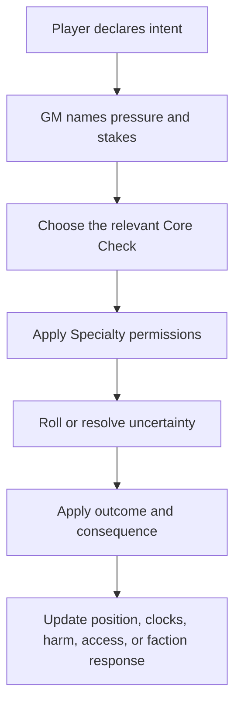

> Historical design material: Core Checks and ranked Specialties are retired. See [current Training rules](../training.md) for implemented behavior. Path progression proposals here are not implemented.

# Resolution Flow

Resolution in Sanguine Archipelago begins with fictional intent and ends with changed circumstances. The system is not built around selecting a move from a fixed combat menu.

## Core Procedure

## Step 1: Declare Intent

The player says what they want to accomplish in the fiction.

Strong intent:

- "I cut the bridge ropes so the soldiers lose the route."
- "I invoke the shrine current to expose the oathbreaker."
- "I bargain with the dockmaster using the Guild seal we earned."

Weak intent:

- "I roll Precision."
- "I use my social skill."
- "I attack."

The mechanic should follow the declared change the player wants to make.

## Step 2: Name Pressure And Stakes

Before a roll, the table should understand what is at risk.

Possible stakes:

- harm
- exposure
- lost time
- worsened position
- faction notice
- resource burn
- corruption
- social obligation
- blocked access

If no meaningful pressure exists, do not roll. Let competent characters act.

## Step 3: Choose Core Check

The Core Check represents the broad competency under pressure.

Example:

A character wants to get through a sealed archive door.

- `Breach`: force or exploit the lock.
- `Broker`: acquire a temporary access right.
- `Signal`: spoof a coded entry request.
- `Guile`: deceive the guard into opening it.
- `Invoke`: call a bound oath in the door's mechanism.

The same objective can invite different checks when the approach changes.

## Step 4: Apply Specialty Permissions

Specialties do not replace the check. They modify what is possible.

Examples:

- `Brace` may allow `Guard` instead of `Reflex` against forced movement.
- `Bargain` may permit a reroll during trade negotiation.
- `Jury-Rig` may make a field repair possible without proper tools.
- `Attune` may reveal a relic's emotional residue before anyone touches it.

If a Specialty only adds a flat bonus, it is probably underdesigned.

## Step 5: Resolve Outcome

Use the table's chosen dice method or success structure, but always translate the result back into fiction.

Outcome bands should answer:

- Did the character accomplish the intent?
- What did it cost?
- What changed in the scene?
- Who noticed?
- What new option or problem exists now?

## Step 6: Update The World

Every important roll should leave a mark.

Update one or more:

- character harm
- scene position
- countdown clocks
- faction reputation
- access permissions
- resources
- corruption
- NPC stance
- environmental state

## Example: Dock Riot

Intent: A Yuma officer wants to stop a dock riot without firing into the crowd.

Pressure: the crowd may scatter into the powder stores, and Free Captain agitators are watching.

Core Check options:

- `Presence`: command attention before panic wins.
- `Grace`: calm leaders and create trust.
- `Pressure`: force compliance with military authority.
- `Signal`: coordinate a visible evacuation route.

Specialty options:

- `Command` may let allies act as a unit.
- `Read` may identify the true instigator.
- `Bargain` may trade concessions for immediate calm.

Outcomes should affect both the crowd and faction response. A clean success may prevent harm but still anger Rebels. A forceful success may save lives while damaging Free Captain reputation.
